<div align="center">

# QwenImage Comic · 本地 AI 创作工作台

**完全离线运行的本地 AI 创作套件** —— 一个引擎驱动七个应用：AI 漫画、图片生成、人像编辑、
捏团子换装、竖屏小剧场、拼豆图纸、游戏素材工坊。全程不联网、不调用任何在线 API，
数据 100% 留在自己电脑上。

`FastAPI` · `ComfyUI` · `Qwen-Image 2.1 (GGUF)` · `Qwen3-VL-8B` · `原生 HTML/JS`

[](https://www.python.org/)
[](https://fastapi.tiangolo.com/)
[](https://github.com/comfyanonymous/ComfyUI)
[](#开源许可)

</div>

---

## 这是什么

项目已从单一漫画工具长成一个**多应用创作工作台**：一个本地引擎（mock / ComfyUI 双模式），
门户统一入口，应用靠 manifest 自动挂载、可独立启动。目前内置 7 个应用：

| 应用 | 独立端口 | 一句话简介 |
|---|---|---|
| 🎨 图片生成 | 8101 | 文生图 / 图生图，任务队列与图库 |
| 📚 漫画工作室 | 8102 | 旗舰应用：剧本到成漫 PDF（见下文详细说明） |
| 🧑‍🎨 人像编辑 | 8103 | 官方五段提示词结构，多参考图人像编辑与智能改写 |
| 🍡 团子衣橱 | 8104 | 捏一个团子，再做一柜子衣服（角色换装工作台） |
| 🎬 团子小剧场 | 8105 | 一句话进去，一条竖屏小片出来（分镜 + 成片） |
| 🧩 拼豆工作台 | 8106 | 图片 → 拼豆图纸：色板量化、抖动、配色清单、可打印图纸（纯 CPU，无需显卡） |
| 🎮 游戏素材工坊 | 8107 | **一句话 → 自动策划 → 分类生成整套游戏素材**（角色/场景×四季/分级武器/建筑/野怪） |

启动门户后浏览器打开 `http://127.0.0.1:8000`，首页卡片点进各应用（`/apps/<应用>/`）；
也可用 `run_app.bat <应用id>` 让单个应用独立跑在自己的端口上。

旗舰应用「漫画工作室」输入一段剧本，会自动完成：**剧本解析 → AI 提取角色 → AI 生成角色立绘 → AI 提取场景 →
AI 智能分镜 → 逐格出图（角色 + 场景融合）→ 拼页排版（气泡/拟声词/页码）→ 一键导出整部 PDF**。

- **文本理解**：复用出图模型自带的 `Qwen3-VL-8B` 文本编码器，通过 ComfyUI `TextGenerate` 节点本地推理，**不需要再下载语言模型**
- **出图引擎**：`Qwen-Image-2.1-Uncensored-GGUF`，走 ComfyUI + ComfyUI-GGUF 通道
- **角色一致性**：使用 Qwen-Image 2.1 官方多参考图编辑通道（`TextEncodeQwenImage21`），场景概念图 + 角色立绘一起喂给模型"边看图边重画"，不是简单拼贴
- **图片生成应用**提供文生图 / 图生图、异步任务队列、图库管理、显存监控；门户首页还聚合了全部应用的图库

> ⚠️ 面向**有 NVIDIA 显卡**的本地玩家：6GB 显存（RTX 2060）实测可跑，但速度较慢（768×768 / 8 步约 18 分钟/张）；
> 显存越大越快。没有显卡也能跑「占位模式」体验完整界面与流程（拼豆工作台除外——它纯 CPU，无需显卡）。

## 效果预览

下面整部漫画**从剧本到成页全程本地生成**：AI 写剧本 → AI 提取角色/场景 → AI 智能分镜 →
Qwen-Image 2.1 出图 → 自动拼页与气泡排版。示例为水墨画风《水漫金山寺》：

| 第 1 页 | 第 2 页 |
|:---:|:---:|
| 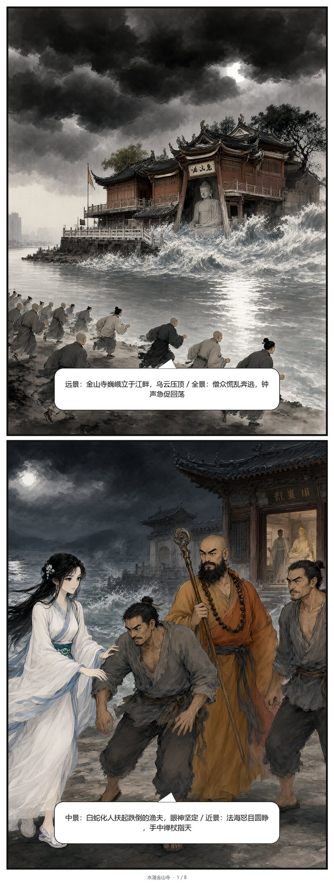 | 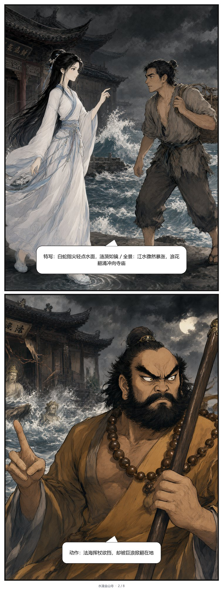 |

<details>
<summary><b>📖 查看全部 8 页</b></summary>
<br>

| 1 | 2 | 3 | 4 |
|:---:|:---:|:---:|:---:|
|  |  |  |  |
| **5** | **6** | **7** | **8** |
|  | 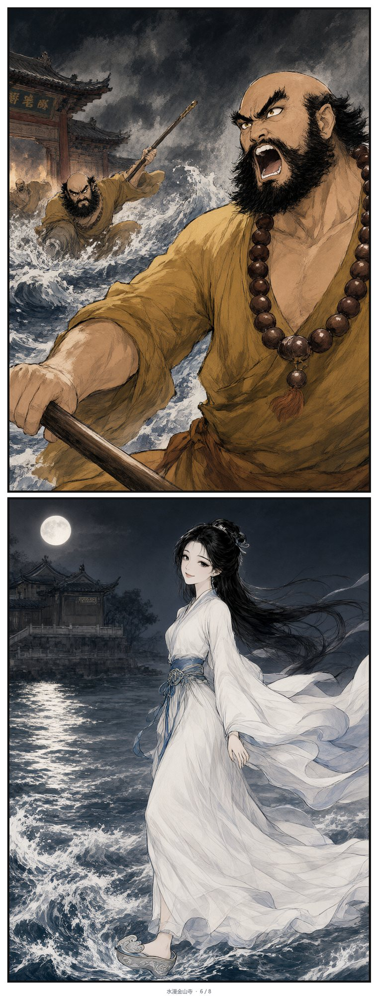 | 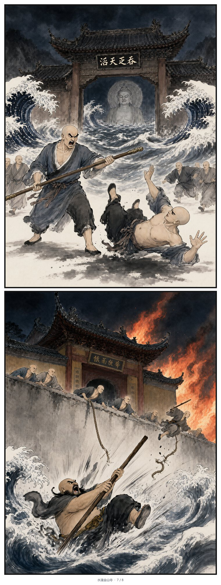 | 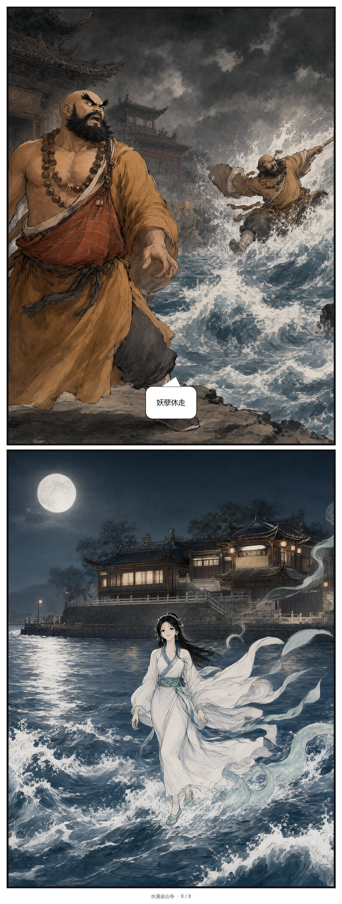 |

</details>

<details>
<summary><b>🖥 界面截图（六步工作流 · 同一项目《水漫金山寺》）</b></summary>
<br>

| 剧本 | 角色提取 | 场景 |
|:---:|:---:|:---:|
| 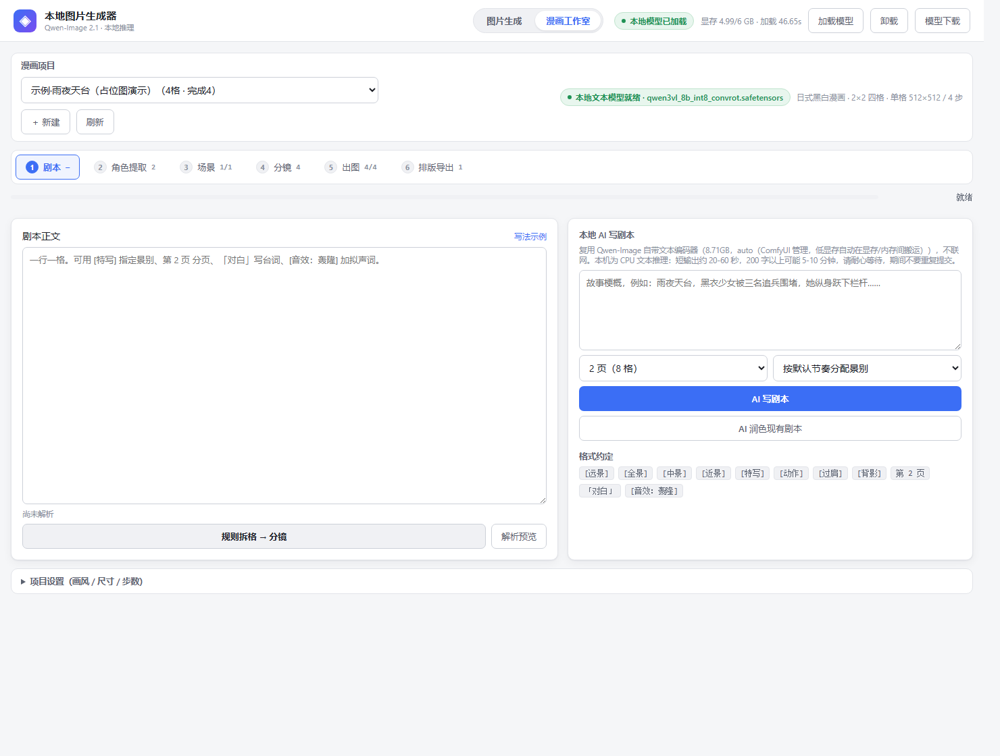 | 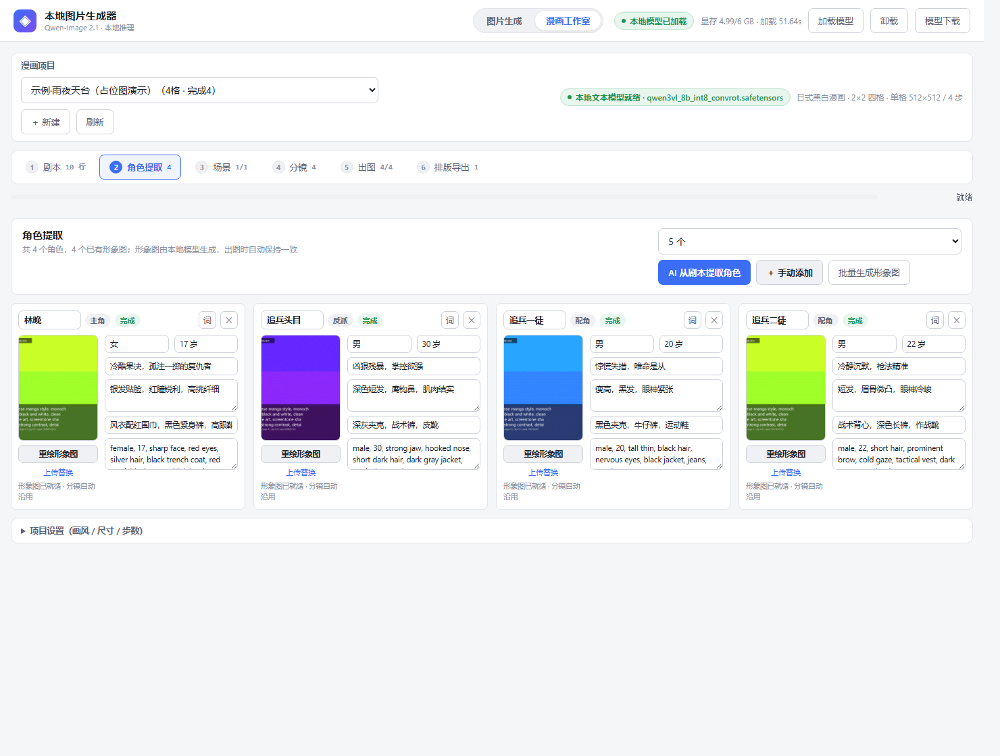 | 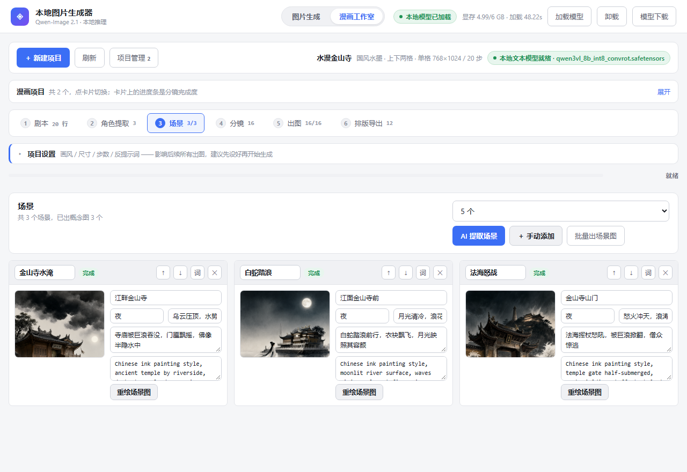 |

| 分镜 | 出图 | 排版导出 |
|:---:|:---:|:---:|
| 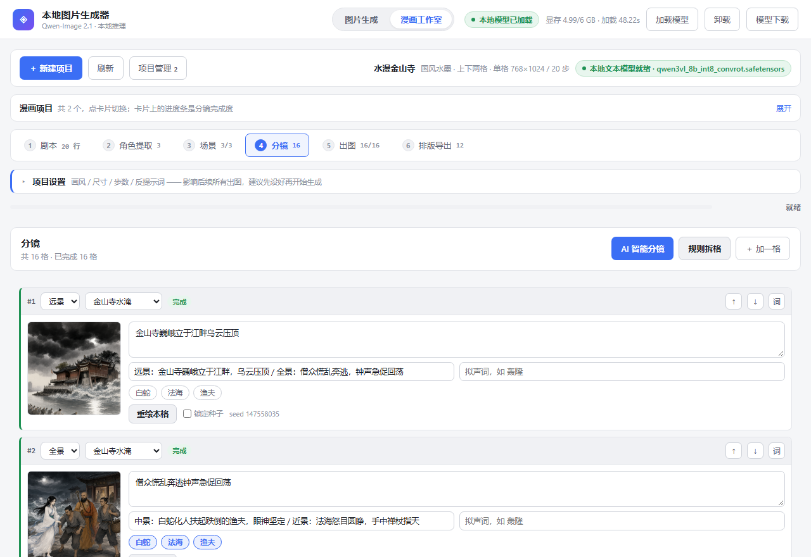 | 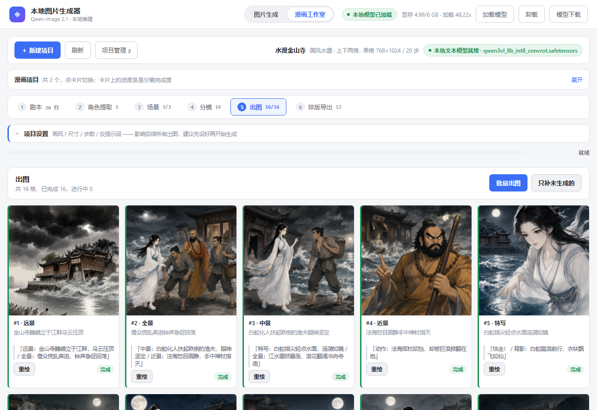 | 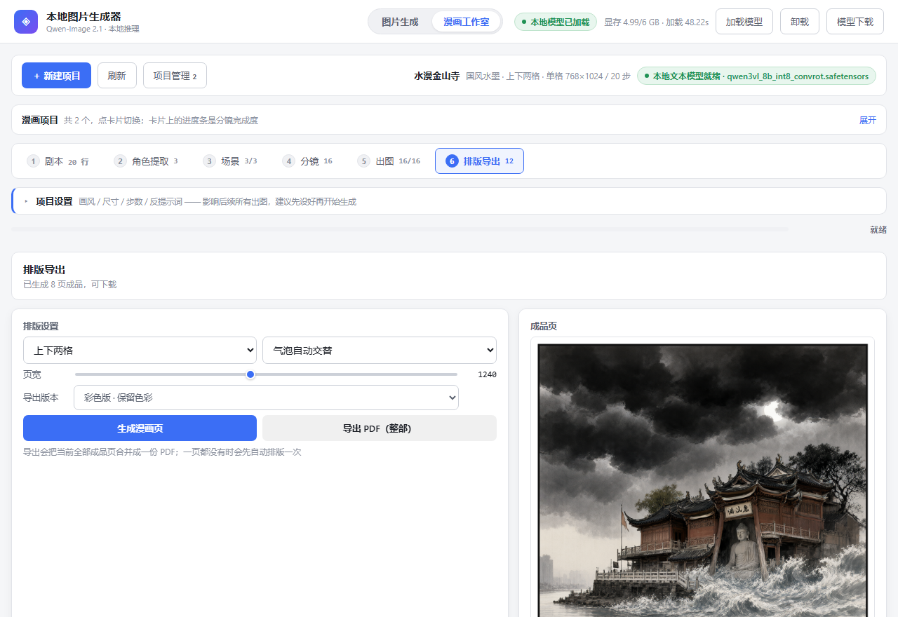 |

</details>

---

## 目录

- [环境要求](#环境要求)
- [懒人版：一键启动包](#懒人版一键启动包)
- [安装步骤](#安装步骤)
  - [方式一：快速体验（无需显卡）](#方式一快速体验无需显卡)
  - [方式二：完整安装（真实出图）](#方式二完整安装真实出图)
- [使用说明](#使用说明)
- [配置说明](#配置说明)
- [目录结构](#目录结构)
- [常见问题](#常见问题)
- [支持作者 💗](#支持作者-)
- [免责声明](#免责声明)

---

## 环境要求

| 项目 | 要求 |
|---|---|
| 操作系统 | Windows 10/11（推荐）、Linux、macOS |
| Python | 3.10 ~ 3.13 |
| 显卡（可选） | NVIDIA，显存 6GB 起（6GB 已按低显存模式调优） |
| 磁盘空间 | 系统盘 3GB + 模型 14.6GB（模型可放任意盘） |
| 网络 | 仅**安装与下载模型**时需要；运行时完全离线 |

---

## 懒人版：一键启动包

不想折腾环境？我另外打了一个 **Windows 绿色版一键启动包**，跳过下面的全部安装步骤：

- **解压即用**：内置 Python 运行时与全部依赖、ComfyUI 与 GGUF 插件，不用装 Python、不用配环境
- **双击 `start.bat` 就能起服务**：自动生成配置，并拉起 ComfyUI 子进程
- **模型权重按需下载**：包内附下载脚本，走国内镜像、支持断点续传（14.6GB 不塞进包里）
- **包体约 5.2GB**，不含任何用户数据，纯净可直接分发

> 📦 **获取方式：写在下方这篇公众号文章里，扫码阅读即可 👇**

<div align="center">


<sub><b>扫码阅读《我在 6GB 显存的游戏本上，做了一个完全离线的 AI 漫画工作室》</b></sub>

<sub>公众号：莹百游素材铺</sub>

</div>

---

## 安装步骤

### 方式一：快速体验（无需显卡）

不装模型、不装 torch，即可完整体验界面、任务队列、图库、漫画流程（出图为占位图）。

```bash
git clone https://github.com/wyfirstname/qwenimage-comic.git
cd qwenimage-comic
```

**Windows**：双击 `start.bat`
**Linux / macOS**：

```bash
bash start.sh
```

脚本会自动完成：创建虚拟环境 `.venv` → 安装 Web 依赖 → 生成 `.env` → 检查端口 → 启动服务。

启动后浏览器打开 **http://127.0.0.1:8000** ，右上角显示「占位模式」即为成功。

### 方式二：完整安装（真实出图）

> **为什么必须走 ComfyUI？**
> Qwen-Image 2.1 是新架构（`qwen_image21`），diffusers（含最新版）暂不兼容；
> ComfyUI 0.37+ 与 ComfyUI-GGUF 已原生支持，是目前 Python 生态唯一可用通道。

#### 1. 安装推理依赖（约 3GB，含 torch）

```bash
# Windows（cmd）
.venv\Scripts\pip install -r backend\requirements-inference.txt

# Linux / macOS
.venv/bin/pip install -r backend/requirements-inference.txt
```

> torch 请按 [pytorch.org](https://pytorch.org/get-started/locally/) 选择与本机 CUDA 匹配的版本；
> 上面命令默认安装 CUDA 版。仅 CPU 体验请自行调整。

#### 2. 安装 ComfyUI 引擎（两个仓库）

```bash
# 2.1 克隆 ComfyUI 到项目根目录的 comfyui/ 文件夹
git clone --depth 1 https://github.com/comfyanonymous/ComfyUI comfyui

# 2.2 安装 ComfyUI 自身依赖（装进项目 .venv，不要给 ComfyUI 单独建环境）
#     Windows（cmd）:
.venv\Scripts\pip install -r comfyui\requirements.txt
#     Linux / macOS:
.venv/bin/pip install -r comfyui/requirements.txt

# 2.3 安装 ComfyUI-GGUF 插件（加载 GGUF 权重必须）
git clone --depth 1 https://github.com/leejet/ComfyUI-GGUF comfyui/custom_nodes/ComfyUI-GGUF

# 2.4 让 ComfyUI 复用本项目的 models/ 目录（不重复占磁盘）
#     Windows（cmd）:
copy scripts\extra_model_paths.yaml comfyui\extra_model_paths.yaml
#     Linux / macOS:
cp scripts/extra_model_paths.yaml comfyui/extra_model_paths.yaml
```

#### 3. 下载模型（约 14.6 GB，支持断点续传）

```bash
# Windows：双击 download_models.bat
# 或命令行：
download_models.bat

# Linux / macOS / Git Bash：
bash download_models.sh
```

脚本走国内镜像 `hf-mirror.com`，下载到 `models/qwen-image-2.1-unc/`：

```
models/qwen-image-2.1-unc/
├── qwen-image-2.1-UC-Q4_K_M.gguf              4.60 GB   扩散模型（推荐档）
├── text_encoders/
│   └── qwen3vl_8b_int8_convrot.safetensors    9.35 GB   文本编码器（Qwen3-VL-8B，兼做本地语言模型）
└── vae/
    └── qwen_image_2.1_vae_bf16.safetensors    0.68 GB   VAE
```

> 中断后重新运行同一脚本即可续传。
> ⚠️ 请勿下载 Q8_0 量化档，社区已验证采样时会张量尺寸不匹配；Q4_K_M / Q5_K_M / Q6_K 可用。

#### 3.5 可选：姿态控制权重（角色/宠物动画强烈建议）

13.3 起动画帧靠 ControlNet 骨架硬控姿势。不装也能跑，但会在卡片上标「姿态无控制」，
出来的帧就会退回「一个姿势画到底」。装法（二选一，**Union 优先**）：

```
① Union 分支（推荐，一条权重管 Canny/Depth/Pose/Lineart…，16G 卡跑得动）
   ComfyUI 插件：https://github.com/T8mars/Comfyui-Qwen-Image-2.1-Fun-Controlnet-Union-T8
                → 克隆到 comfyui/custom_nodes/ 后重启
   权重：Qwen-Image-2.1-Fun-Controlnet-Union-ComfyUI.safetensors
        → 放 models/controlnet/（已由 extra_model_paths 映射，ComfyUI 也认 comfyui/models/controlnet/）

② Control-LoRA 兜底（ComfyUI 内置节点就有，不用装插件）
   qwen_image_union_diffsynth_lora.safetensors → 放 models/model_patches/
```

放好后重开「参数」弹窗，会在「姿态控制」下方直接显示**本机可用/不可用**（`/presets` 的
`control_capability`），不用等出图才发现。**注意**：Union 权重是按 Qwen-Image 2.1 基座训练的，
本项目用的是 `-UC` 量化档；先跑一张确认姿势被拉动，再整组批量跑。

#### 4. 切换引擎并启动

编辑根目录 `.env`（没有就先 `copy .env.example .env`），修改：

```ini
ENGINE_MODE=comfy
```

再次运行 `start.bat`（或 `bash start.sh`）。启动后会**自动拉起 ComfyUI 子进程**（约 45 秒）
并按需加载模型，无需任何手动操作。浏览器打开 http://127.0.0.1:8000 即可真实出图。

---

## 使用说明

### 图片生成

提示词 / 负面提示词 / 尺寸预设 / 步数 / 引导系数 / 种子锁定 / 批量张数；
图生图支持拖拽参考图与重绘强度调节；任务队列 SSE 实时进度；图库支持搜索、收藏、参数复现。

### 漫画工作室

门户首页卡片「漫画工作室」进入（`/apps/comic/`，独立模式 `run_app.bat comic`，端口 8102）。六步分步流程：

| 步骤 | 说明 |
|---|---|
| 1 剧本 | 粘贴手写剧本，或输入梗概让 **AI 写剧本 / AI 润色**（超过 4 页自动分幕连续生成） |
| 2 角色提取 | **AI 从剧本提取角色** → 一键「生成形象图」由本地模型自绘立绘（固定种子保证一致性），也可上传自己的图替换 |
| 3 场景 | **AI 提取场景**生成设定卡，可逐个或批量生成场景概念图 |
| 4 分镜 | **AI 智能分镜**（自动绑定角色与场景）+ 规则拆格兜底 |
| 5 出图 | 批量/逐格出图，角色立绘 + 场景概念图经官方多参考图通道融合 |
| 6 排版导出 | 拼页 + 自动气泡/拟声词/页码，**一键导出整部 PDF**（彩色版 / 黑白版可选） |

**剧本写法（一行一格）**：

```
第 1 页
【远景】雨夜的旧城区，霓虹在积水里碎成一片。
[特写] 小雨的眼睛。「这就是最后一战了吗？」
林默：别回头，跟我走。
[音效：轰隆] 雷声滚过楼群。
== 第2页 ==
[动作] 两人在巷道里狂奔。
```

- `[景别]` / `【景别】` 指定镜头；不写则按节奏自动轮换
- `「对白」`、`“对白”`、`角色名：台词` 均识别为对话（渲染成气泡）
- `[音效：xx]` 生成拟声词角标；`第 N 页` / `===` 分页

> 💡 出图较慢（6GB 显存下单格约 18 分钟）。建议先用 4~6 步小图把全部分镜构图验一遍，
> 再对满意的格子用 8 步重绘。AI 写剧本也较慢（每幕 15-30 分钟），均为后台任务，可取消。

### 画风库 · 主题色 · 生成档位

漫画工作室内置 [yang0/handraw-style](https://github.com/yang0/handraw-style)（MIT，v1.8.5）画风库：

- **画风库 327 + 常用 5**：8 大分组（国际社论幽默 / 经典绘本 / 现代平面 / 日本当代 / 新国风 / 3D 黏土 / 动漫赛璐璐 / 先锋实验），
  项目设置里下拉可直接选（带编号 + 参考作者），或点「浏览」按**缩略图网格**挑选（支持分组筛选 / 搜索 / 分页）。
  画风以「编号 + 生成名 + 参考作者 + 核心风格特征」注入提示词；
  缩略图由 `python scripts/fetch_style_library.py` 一次性抓取（不进 git，缺失时界面自动降级为纯文字）。
- **主题色 36**：克莱因蓝、中国红、祖母绿……一行文本注入提示词，并**外溢到排版配色**
  （气泡描边与文字、分格边框、拟声词、页码全部跟随），整本漫画立刻成套。支持主色 + 点缀色。
- **生成档位**：一套代码适配两种硬件 ——
  「开发档」768×768 / 8 步（6GB 友好）、「目标档」1024×1024 / 24 步（16GB 画质），
  新建项目时选档，项目里可随时切回自定义手动调分辨率 / 步数 / 引导系数；
  还可设候选张数（16GB 下 batch 2~4 一次出多张挑）。
- **分镜节奏模板**：handraw 的 71 种漫画分镜（SB-*）按节奏语义归成 10 个家族
  （稳定叙事 / 层层逼近 / 对峙博弈 / 动作爆发…），选定后分镜的景别序列按模板节奏走
  （仍走逐格出图通路；强依赖整页画布的模板会标注「降级可用」）。

> ⚠️ 画风还原度请以目标档（16GB 机器）实测为准：小分辨率 + 少步数下风格词几乎无法生效，
> 这不是画风库的问题，是采样预算的问题。

### 人像编辑

门户首页卡片「人像编辑」进入（`/apps/portrait/`，独立端口 8103），按 Qwen-Image 官方图像编辑玩法实现：
提示词严格套用官方五段结构（**锁定身份 → 变更内容 → 光线 → 构图 → 画质与禁止项**）：

| 玩法 | 参考图 | 级别 | 说明 |
|---|---|---|---|
| 场景重绘人像 | 1 张 | 语义级 | 保持人物身份，整体重建背景（红树林 / 室内抓拍等官方示例） |
| 发型编辑 | 1 张 | 外观级 | 局部改发型，取景构图人物位置"三不变" |
| 表情编辑 | 1 张 | 外观级 | 改表情不改身份，手部结构约束 |
| 老照片修复 | 1 张 | 语义级 | 官方英文提示词，强调"修复而非虚构" |
| 照片风格化 | 1 张 | 语义级 | 整体重绘为指定风格，保留构图与身份 |
| 多人合成 | 2~3 张 | 语义级 | 人+人 / 人+商品 / 人+场景，按 image_N 引用融合 |
| 换装 | 2 张 | 语义级 | 参考图服装迁移到人物身上 |
| 编辑风人像 | 0 张 | 文生图 | 无需参考图，直接生成编辑质感人像 |

- 参考图自动按**像素预算归一化**（≤0.8MP、最长边 ≤1280、边长 64 对齐），6GB 显存友好
- 输出尺寸跟随第 1 张参考图（image_1）
- 支持**智能改写**：把随手写的描述改写成官方结构化提示词（后台任务，可取消）
- 出图走独立的 `outputs/portrait/<日期>/` 目录，与漫画输出互不干扰

### 团子小剧场

门户首页卡片「团子小剧场」进入（`/apps/storyboard/`，独立端口 8105）：
写选题 → 生成分镜（规则秒出，可选 AI 重写）→ 出定妆照 → 逐格出首帧 → 渲染成片，
两个慢活（AI 重写、渲染）都跑后台线程，前端轮询进度，出图走引擎串行队列。

### 团子衣橱

门户首页卡片「团子衣橱」进入（`/apps/dango/`，独立端口 8104）：
捏一个团子（体型 / 脸型 / 表情），再做一柜子衣服——服装走统一的基准图锚定，
换装结果风格一致。

### 拼豆工作台

门户首页卡片「拼豆工作台」进入（`/apps/perler/`，独立端口 8106），**纯 Pillow CPU 运算，无需显卡**：

- 上传 / 拖拽任意图片 → 选色板（基础 24 / 常用 48，`data/perler/palettes.json` 可自定义）→ 选拼豆板规格（29×29 / 58×58 / 87×87）
- 处理管线：LANCZOS 缩豆 → 色板最近邻匹配 → 可选 Floyd-Steinberg 抖动 → 逐色统计
- 输出：成品预览、带坐标与中文图例的可打印图纸 PNG、配色清单（尺寸 / 豆数 / 色号），图纸 JSON 可导出复用

### 游戏素材工坊

门户首页卡片「游戏素材工坊」进入（`/apps/gameassets/`，独立端口 8107）。
**输入一句话，系统自动策划并分类生成整套游戏素材**：

- **自动策划**：LLM 完善设定（角色 / 宠物 / 分级武器 / 建筑 / 野怪），LLM 不可用时规则兜底；规模档精简约 17 张 / 标准约 26 张 / 豪华约 35 张
- **三层一致性**：6 种美术风格 × 6 种时间背景的风格基因提示词 + 场景基准图融合锚定（CFG=1）+ Pillow 色板后验评分（跑色自动标红）
- **四季场景**：每个场景自动扩展春夏秋冬变体，色调阈值按季放宽
- **分类独立生成**：8 个阶段（策划/基准图/场景/角色/宠物/武器/建筑/野怪）各自状态机、独立重试，一类失败不影响其他类；服务中断自动恢复，点「生成」从断点续做不重跑已出素材
- **5.0 精修与交付**：质量守门（黑图/纯色/跑色自动换 seed 重试）· 透明底（白底色键 / rembg AI 抠图按类切换）· 按类画幅（场景 16:9、角色 2:3、武器/宠物/野怪 1:1、建筑 4:3）· 方案可视化编辑（增删改条目只重跑受影响项）· 单张多候选挑选 + 版本历史回滚 · 筛选重跑（只跑失败/只跑跑色/只跑某季）· 阶段可取消 · 一键导出 ZIP（按类分目录 + manifest.json + 配色 CSV + Unity/Godot/Phaser 导入清单）· 图集拼版导出
- **6.0 分类页签**：每个分类独立页签（阶段进度 + 条目清单 + 成图墙），**主角分男女**（同一主角男女各一版，方案编辑里可按角色勾选性别）、**按类提示词**（每类可单独追加正向/负面词，只影响该类，UI 直接改不用动代码）、按性别筛选重跑（只跑男版/女版）
- **7.0 画幅有据可查**：**怪物按等级分档**（杂兵 640 / 精英 768 / 首领 896 / 终局 1024，画幅随等级走、等级词进提示词）、**场景按用途定画幅**（横版战斗 16:9 1152×640 / 可平铺地表 1:1 1024 / 竖屏副本 2:3 768×1152 / 章节横幅 9:4 1152×512 / 等距战场 1:1 896，每档都写明「为什么这么大」并在 UI 显示）、**场景 ↔ 怪物配属**（每只野怪挂出没场景，提示词带环境上下文，策划页直接展示对应关系）、按等级 / 按场景筛选重跑，导出清单带用途与配属字段
- **10.0 ~ 12.1 主角与宠物三段动画**：2.5D 斜 45° 视图锁（所有素材共用一台相机）· 站立/行走/奔跑三段（lite 3 向 40 帧 / standard 5 向 100 帧 / full 8 向 160 帧）· 每向一张精灵图集 + 大话西游式经典整表（行=朝向、列=步态帧，走/跑各一张）· 逐朝向落库 + 增量续跑（中断不报废，重跑只补缺的朝向）
- **13.0 三层分布出帧（换路线）**：**身份卡 → 关键姿态 → 插值补帧**。逐帧文生图是拿概率模型对抗「同一个人」，40 帧像 40 个人、守门又只量黑图跑色量不出「不像」；改成分层后身份由参考图决定：① 身份卡（一张图并排画同一角色的 3~8 个朝向，全朝向共用，1~2 次出图）；② 关键姿态（每向只出站立 2 / 行走 4 / 奔跑 4 张，图生图参考图 = 基准图 + 身份卡对应那一栏）；③ 插值补帧（接触帧压低、过渡帧抬高，整帧垂直位移补中间帧，不烧显存）。**lite 40 帧从 40 次出图降到 21 次，full 160 帧从 160 次降到 82 次**；动画弹窗可直接打开身份卡，导出包内含 `anim/design_*.png` 与「身份卡 / 关键姿态 / 插值」三层账目
- **13.1 出一张显示一张（可见性）**：动画帧改成**每落一张图就冲一次库**——点下「生成」立刻出现卡片并写明「正在画身份卡」，身份卡出来的瞬间就带图，之后每张关键姿态都更新缩略图、进度行（「正面 · 行走 2/4 · 已 11 分钟」）、小图墙（封顶 16 张）与阶段条（`身份卡 3/21 张`）。此前一小时的生成过程界面完全静止，用户会判定「系统卡死/报错」。配套修掉 `_url_of` 重复定义（第二份盖掉第一份，传字符串就炸）、阶段条长文案把按钮挤成竖排、以及条目收尾不清 `stages.live` 导致「当前项」永久挂起
- **13.3 姿态控制：OpenPose 骨架 + ControlNet Union（角色能动起来）**：13.0~13.2 解决的是「像不像同一个人」，没解决「姿势对不对」——融合编辑是 denoise=1、输出几乎完全跟着参考图画布走，提示词里的 `left foot forward` 只是软约束。用户 16G 机器实拍的一整张 8×8 走路表里 64 格几乎同一个站姿、朝向也只是「正面的近亲」，就是这么来的。现在每个朝向的每个关键姿态都先由程序画一张 **OpenPose 18 点骨架图**（3D 关节角 + 朝向 yaw + 20° 俯角投影，卡通 3.5 头身），作为 ControlNet 的硬约束喂进去：走路 4 拍真的抬腿、侧面真的侧过去、背面真的背对。新增 `pose.py`（**不需要 dwpose 之类预处理器，不额外占显存**）、`controlnet.py`（运行时探测**Union 分支** `QwenImage21UnionApply(control_mode=Pose)` 或 **Control-LoRA 兜底**，都缺就明确报「缺哪个权重、放哪个目录」，绝不静默退化）。`anim_control` 三档：`auto`（默认，有 Union 就用）/`pose`（缺权重直接报错，批量跑前自检）/`off`；强度默认 0.8、采样区间 0~0.9（最后 10% 放开补衣褶）。**顺带修掉一个真 bug**：关键姿态的参考图顺序原本是「基准图在前」，而 image_1 是画布——等于每帧都以前面那张站姿图为画布去画背面/侧面，现在改成「该朝向那一栏在前、基准图退为 image_2」。降级、成功、关闭三种结局都会写进 `anim.control`（`mode/requested/strength/frames/reason`），卡片上显示「🦴 骨架 N」或「姿态无控制」——不再出现「看起来做了」的谎
- **13.2 每朝向人工确认（可控性）**：角色/宠物**每个朝向只先出 1 张确认帧**，在卡片上停下等人点「通过 / 重画这一帧 / 重画身份卡」，通过后才继续该朝向剩下的帧——首帧就歪时只亏 1 张，而不是沿着歪的那张再烧 9 张。驳回可写「哪里不对」，修正词会拼进下一张的提示词；「重画身份卡」会连多栏身份卡一起重出（身份卡错了后面全错）。等待期间阶段条显示「待确认」而不是假装在转，取消/超时（默认 6 小时）都走取消语义、不留点不动的按钮；`off`（全自动）/`dir`（默认，每朝向）/**`design`**（身份卡也确认）三档，在「参数」里改。接口：`POST /sets/{sid}/anim/confirm`
- 单张出图（2060 6GB + Q3_K_S 量化）融合路径约 2~4 分钟，lite 档 16 张一小时内跑完
- 抠图依赖：色键方案零依赖（默认）；rembg 方案需 `pip install rembg onnxruntime`，
  模型放 `models/rembg/models/u2net/u2net.onnx`（约 176MB，便携包已自带离线可用）

---

## 配置说明

所有配置在根目录 `.env`（首次启动自动从 `.env.example` 生成），改后重启服务生效：

| 变量 | 默认 | 说明 |
|---|---|---|
| `ENGINE_MODE` | `mock` | `mock` 占位出图 / `comfy` ComfyUI 真实出图（**推荐**）/ `local` diffusers 直连（暂不兼容 2.1） |
| `HOST` / `PORT` | `127.0.0.1` / `8000` | 服务地址 |
| `WORKERS` | `1` | **必须为 1**，多进程会重复加载模型 |
| `COMFYUI_AUTOSTART` | `true` | 启动时自动拉起 ComfyUI 子进程 |
| `COMFYUI_DIR` | `comfyui` | ComfyUI 所在目录 |
| `COMFYUI_EXTRA_ARGS` | `--lowvram` | ComfyUI 启动参数；显存 ≥12GB 可删除以提速 |
| `MODEL_DIR` | `models/qwen-image-2.1-unc` | 模型目录 |
| `DEVICE` | `cuda:0` | 扩散模型设备 |
| `LOW_VRAM` | `false` | 显存不足时把部分计算卸载到内存 |
| `DEFAULT_WIDTH/HEIGHT` | `768` | 默认出图尺寸（64 的倍数） |
| `DEFAULT_STEPS` | `8` | 默认采样步数 |
| `INFER_TIMEOUT_SECONDS` | `2400` | 单张推理超时（低显存实测约 18 分钟/张，需留足） |
| `VAE_TILING` | `true` | 大图分块防 OOM |
| `LLM_ENABLED` | `true` | 漫画 AI 文本功能（剧本/角色/场景/分镜）开关 |
| `MAX_OUTPUT_DIR_GB` | `50` | 输出目录配额 |
| `NSFW_FILTER` | `flag_only` | `off` / `flag_only` / `block`，由使用者自行决定 |

<details>
<summary><b>显存与画质档参考</b></summary>

| 量化档 | 扩散模型大小 | 建议显存 |
|---|---|---|
| Q4_0 | 4.15 GB | 8 GB |
| **Q4_K_M（默认）** | **4.60 GB** | **6–12 GB** |
| Q5_K_M | 5.22 GB | 12 GB |
| Q6_K | 5.88 GB | 12–16 GB |

换档方法：修改模型下载脚本中的文件名 + `.env` 的 `TRANSFORMER_FILE`，重新下载对应权重。

</details>

---

## 目录结构

```
qwenimage-comic/
├── start.bat / start.sh              一键启动（自动建环境/装依赖/生成 .env）
├── download_models.bat / .sh         一键下载模型（断点续传）
├── .env.example                      配置模板
├── shared/                           底座：配置、数据访问、SQLite、任务存储（全应用共用）
│   ├── config.py / models_util.py
│   ├── repo.py / db.py               出图记录与任务队列（blobs 大字段外置防库膨胀）
│   └── webapp.py / promptlib/        前端挂载工具 / 提示词库（画风、分镜节奏）
├── engine/                           引擎层：mock / ComfyUI 双模式，串行队列保显存
│   ├── generation.py / sdk.py        generate_sync 统一入口 + job hook 回填
│   ├── slots.py / tts/               显存槽位 / 语音（edge-tts）
│   └── infer/
│       ├── comfy_engine.py           ComfyUI API 适配（2.1 多参考图 / 融合 / 文生图）
│       ├── comfy_text.py / schema_guard.py  文本推理与工作流守门
│       └── scheduler.py              串行调度器
├── apps/                             业务应用层（manifest.json 自动被门户发现挂载）
│   ├── imagegen/                     图片生成（8101）
│   ├── portrait/                     人像编辑（8103）
│   ├── dango/                        团子衣橱（8104）
│   ├── storyboard/                   团子小剧场（8105）
│   ├── perler/                       拼豆工作台（8106，纯 CPU）
│   ├── gameassets/                   游戏素材工坊（8107）
│   └── comic/                        漫画工作室（旗舰，六步工作流）
├── portal/                           门户：统一导航 + 应用注册发现 + 图库
│   └── frontend/                     门户 Web UI（原生 HTML/CSS/JS，无构建步骤）
├── backend/                          兼容层：requirements 与回归测试（pytest）
├── scripts/
│   ├── download_models.py            模型下载脚本
│   ├── fetch_style_library.py        画风库缩略图抓取（一次性，缩略图不入库）
│   ├── test_perler.py / test_gameassets.py  应用自测脚本
│   └── extra_model_paths.yaml        ComfyUI 模型路径映射模板
├── docs/                             项目设计文档与界面截图
├── assets/                           README 资源
├── models/                           模型权重（自行下载，不入库）
├── comfyui/                          ComfyUI 引擎（自行 clone，不入库）
└── data/                             运行数据：数据库、出图、导出 PDF（不入库）
```

所有运行数据都落在项目目录内，删除 `data/` 即可完全重置。

---

## 常见问题

<details>
<summary><b>双击 start.bat 一闪而过 / 看不到报错</b></summary>

在项目目录地址栏输入 `cmd` 回车，手动执行 `start.bat` 查看完整报错。
`start.bat` 刻意保持纯 ASCII，请勿用编辑器加入中文后另存为 UTF-8。
</details>

<details>
<summary><b>提示 Port 8000 is already in use</b></summary>

上次服务未正常关闭。任务管理器结束对应 PID，或 `taskkill /F /PID xxx`；也可改 `.env` 的 `PORT`。

⚠️ Windows 下 `SO_REUSEADDR` 允许两个实例绑同一端口并争抢 SQLite，务必确保只有单实例在跑。
</details>

<details>
<summary><b>出图报「未找到 ComfyUI」</b></summary>

未完成「安装步骤 2」：确认 `comfyui/main.py`、`comfyui/custom_nodes/ComfyUI-GGUF`、
`comfyui/extra_model_paths.yaml` 三者存在。
</details>

<details>
<summary><b>模型文件缺失 / GGUF 无法加载</b></summary>

界面右上角「模型下载」可核对三个文件是否齐全。GGUF 加载失败时程序会**明确报错**而不是静默出假图；
请确认下载的是 Q4_K_M / Q5_K_M / Q6_K 档（Q8_0 已知不兼容）。
</details>

<details>
<summary><b>CUDA out of memory</b></summary>

降到 768×768（或直接选「开发档」）、开启 `LOW_VRAM=true`、`COMFYUI_EXTRA_ARGS=--lowvram`，
并关闭其他占显存的程序。
</details>

<details>
<summary><b>漫画出图一直「排队中」</b></summary>

6GB 显存下单格约 18 分钟，批量是串行的，N 格 = N×18 分钟，属正常。界面顶部有进度条；
超过 40 分钟无进展再刷新页面，后端会按任务真实状态自动校正。
</details>

<details>
<summary><b>后台卡住了 / 进度长时间不动，怎么恢复</b></summary>

进度条旁边有「中断并恢复」按钮（正常情况下它是隐藏的，出现「疑似卡住」提示时才会亮出来）。
点它会结束当前任务、复位推理引擎，必要时重启 ComfyUI 子进程，**不需要重启整个服务**。

后端自身也有兜底，不用你盯着：

| 情况 | 触发条件 | 后端动作 |
|---|---|---|
| 疑似卡死 | AI 任务超过 240 秒没有任何进度 | 任务打上 `stuck` 标记，界面提示并亮出恢复按钮 |
| 取消不退出 | 取消后 45 秒工作线程仍在跑 | 自动升级为「硬恢复」：中断 + 重启 ComfyUI |
| 硬超时 | 超过 `LLM_TIMEOUT_SECONDS` + 120 秒无进展 | 自动硬恢复并把任务标为失败（可重试） |
| 后端进程重启 | 启动时 | 把上次遗留的 `running/queued` 任务标为中断，并收敛分镜/场景/角色图的「排队中」状态 |

恢复采用「换世代」机制：即使某个推理线程真的永远回不来，它也不会再占住任务队列，
新任务照常执行。想手动触发系统级恢复（含失联的出图任务）：

```bash
curl -X POST "http://127.0.0.1:8000/api/v1/system/recover?hard=true"
```

若日志提示「ComfyUI 不是由本服务拉起的」，说明 ComfyUI 是你自己启动的，程序不会替你杀进程，
请手动重启它（或改由 `start.bat` 拉起）。
</details>

<details>
<summary><b>改了前端没生效</b></summary>

服务对 `/static` 已下发 no-cache 并带版本指纹；若仍异常，请 `Ctrl+F5` 强刷。
</details>

---

## 支持作者 💗

如果这个项目帮到了你，欢迎请作者喝杯咖啡 ☕

<div align="center">
  <table>
    <tr>
      <td align="center">
        <br>
        <sub><b>微信赞赏</b> · 金额随意，您的支持是持续更新的动力</sub>
      </td>
      <td align="center">
        <br>
        <sub><b>公众号</b> · 扫码关注，获取项目更新与教程</sub>
      </td>
    </tr>
  </table>
  <p><sub>也可以通过这些方式支持：给项目点个 <b>Star ⭐</b>、提交 Issue / PR、把项目分享给需要的朋友。</sub></p>
</div>

---

## 免责声明

1. 默认模型基于 **Qwen Research License**，商用请自行确认条款；社区的 Uncensored 转换版许可状态更模糊。
2. 该模型版本**移除了内置安全检查器**，输出完全取决于提示词。使用者须对生成内容负全部责任，
   遵守所在地法律法规，不得用于生成违法内容或侵害他人权益。
3. 本地生成 ≠ 可自由传播，对外发布前请自行做合规审查。
4. 项目保留 `NSFW_FILTER` 开关与生成记录，建议按需开启。
5. 本项目与阿里云 / Qwen 官方无关联，仅为社区第三方工具。

## 开源许可

本项目代码采用 [MIT License](LICENSE) 发布；模型权重遵循其原始许可协议。

---

<div align="center">
<sub>用 ❤️ 和大量显卡时间制作 · 如果对你有帮助，欢迎 Star</sub>
</div>
